# Workspace runtime graph

How the workspace runtime (`scythe-web/`) is wired, drawn from the source by `tools/workspace_graph.py` so it can be regenerated and compared, not redrawn by hand.

- **Commit:** `39822c42`, measured 2026-10-25.
- **Tool:** `tools/workspace_graph.py` (JSON by default, `--mermaid` for the diagram below, `--ref <commit>` for any commit). Tests: `tools/test_workspace_graph.py`
  (`cd tools && python3 -m unittest test_workspace_graph`).
- **Snapshot:** `docs/architecture/workspace-graph.json` is the tool's output for this commit. Companion to `docs/architecture/workspace-baseline.md`, which counts things.

## What the edges mean

The edges come from text patterns, so they are a map to check against the code, not a proof.

| Edge | Read from |
|---|---|
| plugin requires service | the tool's `requires: [...]` list |
| plugin uses service | a `ctx.services.get("x")` call (a service used but not required, or the other way round, is a finding) |
| service provided by the boot module | a `workspace.provide("x", ...)` call in `workspaceBoot.js` |
| service reads a window global | a `win.X` read (not an assignment) in the text of that `provide` call, up to the next `provide`/`register` (approximate) |
| module imports module | `import ... from "./x.js"` |

The window globals a service reads fall into four kinds: **page** (the page's own, the legacy surface), **runtime** (set by `workspaceBoot.js` itself: a tool's controls or a store, so
the runtime reached through the window), **library** (`Cesium`, `io`) and **browser** (`console`, `fetch`, ...).

## Plugins, services and window globals

Solid arrows: a plugin requires a service. Dotted arrows: a service reads a page or runtime global (libraries and browser built-ins are left out).

```mermaid
flowchart LR
  p_adsb["adsb"]
  p_ais_stream["ais-stream"]
  p_chat["chat"]
  p_entity_sync["entity-sync"]
  p_fusion["fusion"]
  p_lpi["lpi"]
  p_metrics["metrics"]
  p_metrics_explorer["metrics-explorer"]
  p_poi["poi"]
  p_presence["presence"]
  p_propagation_ui["propagation-ui"]
  p_recon["recon"]
  p_render["render"]
  p_rooms["rooms"]
  p_sensors["sensors"]
  p_session["session"]
  p_viewsheds["viewsheds"]
  p_websocket_sync["websocket-sync"]
  s_activityLog(["activityLog"])
  s_aisApi(["aisApi"])
  s_cameraView(["cameraView"])
  s_chatView(["chatView"])
  s_clock(["clock"])
  s_entityConsole(["entityConsole"])
  s_entityFeed(["entityFeed"])
  s_entityMarkers(["entityMarkers"])
  s_entityStream(["entityStream"])
  s_explorerView(["explorerView"])
  s_fetchJson(["fetchJson"])
  s_frames(["frames"])
  s_fusionData(["fusionData"])
  s_fusionGlobe(["fusionGlobe"])
  s_httpFetch(["httpFetch"])
  s_liveSources(["liveSources"])
  s_lpiGlobe(["lpiGlobe"])
  s_lpiSensors(["lpiSensors"])
  s_lpiView(["lpiView"])
  s_metricsProbe(["metricsProbe"])
  s_notify(["notify"])
  s_openEventSource(["openEventSource"])
  s_operatorSession(["operatorSession"])
  s_poiConsole(["poiConsole"])
  s_poiGlobe(["poiGlobe"])
  s_postJson(["postJson"])
  s_presenceGlobe(["presenceGlobe"])
  s_presenceSource(["presenceSource"])
  s_presenceView(["presenceView"])
  s_propagationEngine(["propagationEngine"])
  s_propagationView(["propagationView"])
  s_realtimeConsole(["realtimeConsole"])
  s_realtimeEnv(["realtimeEnv"])
  s_realtimeSocket(["realtimeSocket"])
  s_reconConsole(["reconConsole"])
  s_reconEntities(["reconEntities"])
  s_reconGlobe(["reconGlobe"])
  s_reconView(["reconView"])
  s_renderEvents(["renderEvents"])
  s_renderGlobe(["renderGlobe"])
  s_roomChanges(["roomChanges"])
  s_roomConsole(["roomConsole"])
  s_roomSync(["roomSync"])
  s_roomView(["roomView"])
  s_sensorGlobe(["sensorGlobe"])
  s_sensorView(["sensorView"])
  s_sessionStore(["sessionStore"])
  s_socketClient(["socketClient"])
  s_syncEvents(["syncEvents"])
  s_terrainModel(["terrainModel"])
  s_vesselSink(["vesselSink"])
  s_viewshedGlobe(["viewshedGlobe"])
  p_adsb --> s_entityMarkers
  p_adsb --> s_realtimeSocket
  p_adsb --> s_fetchJson
  p_ais_stream --> s_realtimeSocket
  p_ais_stream --> s_syncEvents
  p_ais_stream --> s_cameraView
  p_ais_stream --> s_aisApi
  p_ais_stream --> s_vesselSink
  p_ais_stream --> s_notify
  p_chat --> s_openEventSource
  p_chat --> s_fetchJson
  p_chat --> s_postJson
  p_chat --> s_chatView
  p_chat --> s_roomChanges
  p_entity_sync --> s_httpFetch
  p_entity_sync --> s_openEventSource
  p_entity_sync --> s_operatorSession
  p_entity_sync --> s_entityConsole
  p_fusion --> s_entityStream
  p_fusion --> s_fusionData
  p_fusion --> s_fusionGlobe
  p_lpi --> s_entityStream
  p_lpi --> s_httpFetch
  p_lpi --> s_entityConsole
  p_lpi --> s_lpiSensors
  p_lpi --> s_lpiView
  p_lpi --> s_lpiGlobe
  p_lpi --> s_frames
  p_lpi --> s_clock
  p_metrics --> s_httpFetch
  p_metrics --> s_metricsProbe
  p_metrics_explorer --> s_httpFetch
  p_metrics_explorer --> s_explorerView
  p_metrics_explorer --> s_liveSources
  p_poi --> s_httpFetch
  p_poi --> s_poiConsole
  p_poi --> s_poiGlobe
  p_presence --> s_presenceSource
  p_presence --> s_presenceView
  p_presence --> s_presenceGlobe
  p_propagation_ui --> s_propagationEngine
  p_propagation_ui --> s_propagationView
  p_propagation_ui --> s_activityLog
  p_recon --> s_httpFetch
  p_recon --> s_openEventSource
  p_recon --> s_operatorSession
  p_recon --> s_entityStream
  p_recon --> s_reconGlobe
  p_recon --> s_reconView
  p_recon --> s_reconConsole
  p_render --> s_renderGlobe
  p_render --> s_renderEvents
  p_rooms --> s_httpFetch
  p_rooms --> s_operatorSession
  p_rooms --> s_roomView
  p_rooms --> s_roomConsole
  p_sensors --> s_httpFetch
  p_sensors --> s_operatorSession
  p_sensors --> s_entityConsole
  p_sensors --> s_reconEntities
  p_sensors --> s_entityStream
  p_sensors --> s_sensorView
  p_sensors --> s_sensorGlobe
  p_session --> s_httpFetch
  p_session --> s_sessionStore
  p_session --> s_cameraView
  p_viewsheds --> s_viewshedGlobe
  p_viewsheds --> s_terrainModel
  p_viewsheds --> s_activityLog
  p_websocket_sync --> s_httpFetch
  p_websocket_sync --> s_operatorSession
  p_websocket_sync --> s_socketClient
  p_websocket_sync --> s_realtimeEnv
  p_websocket_sync --> s_entityFeed
  p_websocket_sync --> s_roomSync
  p_websocket_sync --> s_realtimeConsole
  s_activityLog -.-> w_logInteraction["win.logInteraction"]
  s_activityLog -.-> w_logMetric["win.logMetric"]
  s_cameraView -.-> w_viewer["win.viewer"]
  s_entityConsole -.-> w_addConsoleMessage["win.addConsoleMessage"]
  s_entityFeed -.-> w_EntitySync["win.EntitySync"]
  s_entityMarkers -.-> w_AutoReconVisualization["win.AutoReconVisualization"]
  s_entityStream -.-> w_EntitySync["win.EntitySync"]
  s_fusionData -.-> w_SensorManager["win.SensorManager"]
  s_lpiSensors -.-> w_SensorManager["win.SensorManager"]
  s_notify -.-> w_addConsoleMessage["win.addConsoleMessage"]
  s_operatorSession -.-> w_OperatorSession["win.OperatorSession"]
  s_poiConsole -.-> w_addConsoleMessage["win.addConsoleMessage"]
  s_presenceSource -.-> w_OperatorSession["win.OperatorSession"]
  s_realtimeConsole -.-> w_addConsoleMessage["win.addConsoleMessage"]
  s_realtimeEnv -.-> w___SCYTHE_BOOTSTRAP__["win.__SCYTHE_BOOTSTRAP__"]
  s_realtimeSocket -.-> w_WebSocketSync["win.WebSocketSync"]
  s_reconConsole -.-> w_ReconStore["win.ReconStore"]
  s_reconConsole -.-> w_addConsoleMessage["win.addConsoleMessage"]
  s_reconConsole -.-> w_showNotification["win.showNotification"]
  s_reconEntities -.-> w_AutoReconVisualization["win.AutoReconVisualization"]
  s_reconGlobe -.-> w_ReconStore["win.ReconStore"]
  s_roomConsole -.-> w_addConsoleMessage["win.addConsoleMessage"]
  s_roomSync -.-> w_RoomManager["win.RoomManager"]
  s_syncEvents -.-> w_WebSocketSync["win.WebSocketSync"]
  s_vesselSink -.-> w_AISStreamManager["win.AISStreamManager"]
```

## Findings

- **18 plugins and 52 services.** Every service a plugin requires is provided by `workspaceBoot.js`, every provided service is required by some plugin, and no plugin uses a service it did
  not list in `requires` or lists one it does not use. (The last two checks skip a file that defines more than one tool; none does today.)
- **14 of the 52 services read no window global at all.** The rest reach into the page through `win.*`.
- **Page globals the services read: 5.** These are the legacy surface that still has to move:

| Window global | Services reading it | Which |
|---|---|---|
| `addConsoleMessage` | 6 | `entityConsole`, `notify`, `poiConsole`, `realtimeConsole`, `reconConsole`, `roomConsole` |
| `AISStreamManager` | 1 | `vesselSink` |
| `__SCYTHE_BOOTSTRAP__` | 1 | `realtimeEnv` |
| `showNotification` | 1 | `reconConsole` |
| `viewer` | 1 | `cameraView` |

  `AISStreamManager` is the one extracted-or-not page object here: it is still a page object (84 lines), and the `vesselSink` service forwards to it, so it is not a plain deletion.
  `__SCYTHE_BOOTSTRAP__` is injected by the server. `addConsoleMessage`, `showNotification` and `viewer` are page functions and the Cesium viewer.
- **Runtime globals the services read: 9.** The boot module sets these itself, so a service that reads one goes out through `window` and back into the runtime. They are the candidates to turn
  into direct service-to-tool dependencies:

| Window global | Services reading it | Which |
|---|---|---|
| `AutoReconVisualization` | 2 | `entityMarkers`, `reconEntities` |
| `EntitySync` | 2 | `entityFeed`, `entityStream` |
| `OperatorSession` | 2 | `operatorSession`, `presenceSource` |
| `ReconStore` | 2 | `reconConsole`, `reconGlobe` |
| `SensorManager` | 2 | `fusionData`, `lpiSensors` |
| `WebSocketSync` | 2 | `realtimeSocket`, `syncEvents` |
| `RoomManager` | 1 | `roomSync` |
| `logInteraction` | 1 | `activityLog` |
| `logMetric` | 1 | `activityLog` |

- **Modules the runtime does not import: 37** of the 75 stores and logic modules. 36 are used by something else in the repo (mostly the standalone
  `regional-rf-demo.html` and `lunar-ops-demo.html` pages, the home page and the globe page); none is referenced by `command-ops-visualization.html`. `offlineHypergraphBundle.browser.js` is
  referenced by no other file by name: the demo page imports `./offlineHypergraphBundle.js`, not this variant, so it is a candidate to delete, not a proven dead file (a build or a script could still name it another way).

## Caveats

- Text patterns, not a parse: a service named through a variable, or a `provide` written another way, would be missed.
- The globals of a service are every `win.X` read in the text of its `provide` call, which can include a neighbour's lines in a long call.
- "Referenced by" uses the module's file name, so a reference that builds the name in code is missed, and a comment that mentions the name counts (documentation, tools and tests are left out).
- Not drawn yet: logic module to logic module imports (they are in the JSON as `modules`), and the page's own objects calling the runtime.
